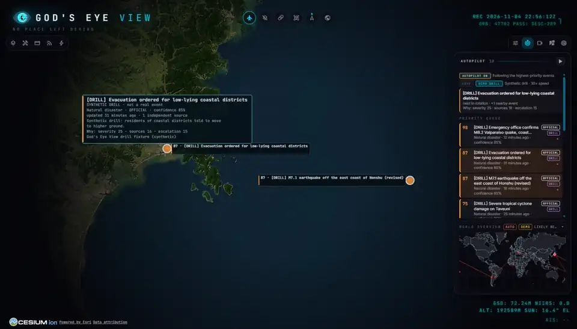
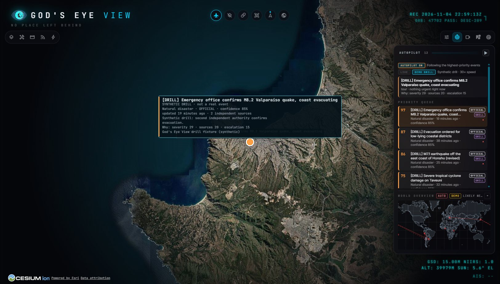
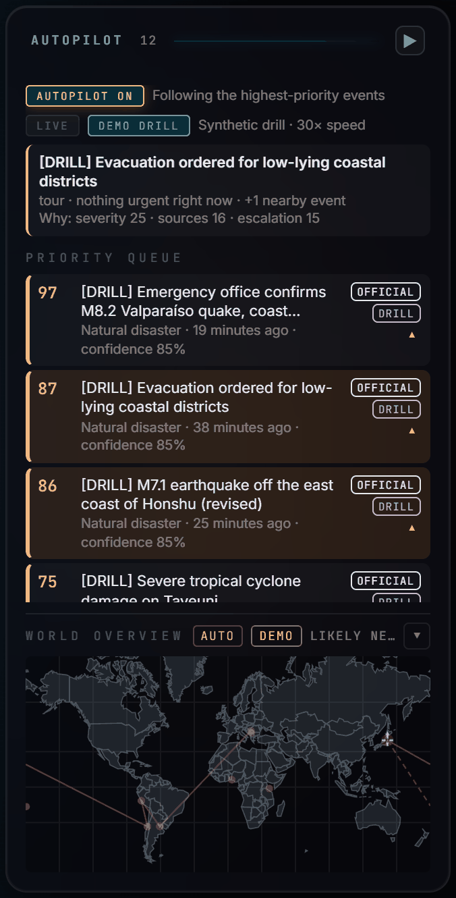
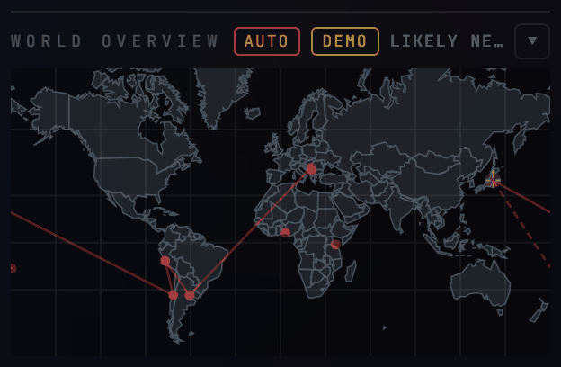

# Global Early-Warning Autopilot (this fork)

This fork adds an Autopilot to God's Eye View. It watches public early-warning feeds,
ranks what it finds by evidence, and flies the camera to the most important event,
then to the next.

_A demo drill at 30× speed: synthetic events, not real ones. The camera holds each shot,
then moves on to the next event. On the right are the priority queue and the world
overview._

<table>
  <tr>
    <td width="45%" valign="top">
      
    </td>
    <td valign="top">

**The AUTOPILOT panel**

- **AUTOPILOT ON / PAUSED / OFF**: follow the highest-priority events, or stay where
  you are.
- **LIVE / DEMO DRILL**: public feeds, or a synthetic drill that never touches the live
  archive.
- **The shot on screen**, with the reasons it was chosen: severity, number of sources,
  freshness and escalation.
- **Priority queue**: every event scored by deterministic rules, with its verification
  badge (`OFFICIAL`, `CORROBORATED`, `UNVERIFIED`) and `DRILL` where it applies.
- **World overview**: the camera, the shot on screen, recent stops and likely next
  ones, on one small map.

</td>

  </tr>
</table>

## What it does

- **Public feeds, no paid service.** USGS earthquakes, GDACS, the tsunami warning
  centres, NWS, NASA EONET, WHO outbreak news, the World Bank, ReliefWeb, and S2
  GhostMaps incidents. GDELT news is opt-in. Reports from several sources are merged
  into one event in a local evidence store.
- **The camera follows the evidence.** Rule-based scores decide what is shown and for
  how long. A critical event can interrupt; anything else waits its turn. With
  nothing urgent, Autopilot can tour lower-priority events.
- **Local AI, optional.** A local model can write assessments and narration, and local
  speech-to-text and text-to-speech handle voice. Nothing goes to a cloud AI.
- **Air & Sea and FAST INTELLIGENCE.** Aggregate traffic layers built from the existing
  aircraft and vessel feeds, and a fast lane for push sources.
- **LIVE TV.** A live news channel at the foot of the left column: Bloomberg, Sky News,
  Euronews, DW News, CNN, France 24, Al Jazeera and RT to start with, and any YouTube
  live or HLS stream you add with the gear. It starts muted and steps aside when
  Autopilot narration speaks.
- **Runs on one Windows PC**, bound to localhost and your LAN.

## Read more

- [EARLY-WARNING.md](EARLY-WARNING.md): architecture, scoring, the API and settings.
- [AUTOPILOT-OPERATOR.md](AUTOPILOT-OPERATOR.md): setting it up and running it on Windows.
- [AUTOPILOT-FEEDS.md](AUTOPILOT-FEEDS.md): every feed and its gaps.
- [WORLD_OVERVIEW.md](WORLD_OVERVIEW.md): the world overview map.
- [FORK-CHANGELOG.md](FORK-CHANGELOG.md) and [FORK-MAINTENANCE.md](FORK-MAINTENANCE.md):
  what the fork changes, and how it keeps up with upstream.

Recorded on 5 November 2026 on an offline local instance (`GEV_INTEL_OFFLINE=1`) with
Esri World Imagery, at 1600 × 900. No API keys were set.
