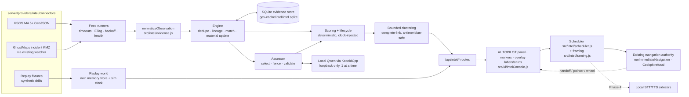

# Early-warning event engine (fork feature)

Status: **Phases 0–3 implemented (event engine, evidence store, AUTOPILOT
console and camera scheduler, local Qwen assessments); Phases 4–6 pending.** Off unless
`GEV_INTEL_ENABLED=1`. This document is the architecture decision record and
operator reference for the Global Early-Warning Autopilot specification
(29 October 2026). It states what exists today; nothing listed as pending is
wired into the UI or advertised in the app.

Guiding principle: the display follows evidence, not noise. The local model
(Phase 3) may interpret; deterministic code owns scoring, lifecycle and (from
Phase 2) the camera; the operator stays in control.

## Architecture



| Module                                | Owner of                                                                         | Notes                                                       |
| ------------------------------------- | -------------------------------------------------------------------------------- | ----------------------------------------------------------- |
| `src/intel/taxonomy.js`               | Categories, states, category lifecycle policy, Autopilot defaults, score weights | Ids only; the UI owns display text                          |
| `src/intel/evidence.js`               | Observation normalization, sanitization, hashing                                 | Source text is inert, length-capped data                    |
| `src/intel/correlate.js`              | Duplicate detection, event matching, lineage, material-change rules              | Every decision returns reasons ("why grouped")              |
| `src/intel/scoring.js`                | Severity, confidence, verification, escalation, attention score                  | Severity and confidence reported separately from attention  |
| `src/intel/lifecycle.js`              | Focus window, marker TTL, fade, archive, retraction                              | Driven by last meaningful update, never by polls or reposts |
| `src/intel/clustering.js`             | Bounded-diameter clustering, bounds, centroid                                    | Uses `greatCircleKm`; no planar degrees                     |
| `src/intel/engine.js`                 | Folding observations into canonical events                                       | Clock and store injected                                    |
| `src/intel/memoryStore.js`            | Reference store contract; replay and test store                                  |                                                             |
| `src/intel/replay.js`                 | Scenario expansion and replay worlds                                             | A drill never writes the live archive                       |
| `server/providers/intel/store.js`     | SQLite store (built-in `node:sqlite`)                                            | Retention, corrupt-file recovery, erase                     |
| `server/providers/intel/feeds.js`     | Polling, bounded HTTP, conditional requests, backoff, circuit breaker, health    |                                                             |
| `server/providers/intel/connectors/*` | Source mappings                                                                  | USGS, GhostMaps                                             |
| `server/providers/intel/kmz.js`       | Bounded KMZ/KML reading without a DOM                                            |                                                             |
| `server/providers/intel/service.js`   | Composition, settings, replay, archive                                           |                                                             |
| `server/providers/intel/index.js`     | `/api/intel` routes and feature flag                                             |                                                             |
| `src/intel/scheduler.js`              | Autopilot attention scheduling (pure step function)                              | Deterministic for the same state, input and clock           |
| `src/intel/framing.js`                | Camera height and centre for a cluster                                           | Spherical cap fit, viewport FOV/aspect, precision floor     |
| `src/intel/client.js`                 | Same-origin `/api/intel` client                                                  | Injected fetch                                              |
| `src/ui/intelConsole.js`              | AUTOPILOT panel, markers, overlay labels/cards, Autopilot controller             | Camera claims via the shared navigation owner               |
| `scripts/qa-autopilot.mjs`            | Browser gate for the console and camera behaviour                                | Real clicks and pointer input                               |
| `src/intel/assessment.js`             | Model prompt, output schema, strict validation, cache key                        | Evidence fenced as untrusted data                           |
| `server/providers/intel/localLlm.js`  | Loopback OpenAI-compatible client (KoboldCpp)                                    | No cloud path; busy check; timeout                          |
| `server/providers/intel/assessor.js`  | Which events the model assesses, when                                            | Serialized cycles, hourly cap                               |

`src/intel/` is portable (no Node, DOM or Cesium) and is not yet a declared
package export; the server imports it like the existing GhostMaps catalog.
`server/providers/local.js` now builds one GhostMaps watcher and hands it to
both the map layer and intel ingestion, so the repository is still watched once.

## Decisions

1. **Event = fold over observations.** Observations are immutable; the event
   holds the current fold and each material change writes a revision. Replay,
   live ingestion and (later) operator un-merge share one path.
2. **Four separate clocks**: report age, camera eligibility (focus window),
   marker lifetime (TTL with fade over the final 25%), archive retention.
   Only a _meaningful_ update moves the second and third; reposts, duplicate
   copies and feed polls never do. Old incidents arriving now are archived on
   arrival.
3. **Lineage, not headline count.** Copies (declared `derived_from`, the same
   lineage key, or near-identical text from another publisher) join the
   original's lineage. Corroboration counts independent lineages. A lineage
   still has to agree in space and time before it merges two reports, because
   one article can describe several incidents.
4. **Consequences link, they do not merge.** An evacuation order or tsunami
   warning near a primary event becomes a linked child (`consequence_of`).
5. **"Important" is not "true".** Claimed severity and impact are weighted by
   confidence (`evidence_factor`) before they influence attention; critical
   (≥ 95) requires official or corroborated reporting with confidence ≥ 0.7,
   otherwise the score is capped and `critical_blocked` explains why. Events
   below `minimumCameraConfidence` (0.35) are candidates, never camera targets.
6. **No invented coordinates.** Reports without a valid point keep only their
   region code and `geolocation_status: unresolved`; clustering frames them by
   region.
7. **Complete-link clustering.** `groupingRadiusKm` is the maximum distance
   between any two members (a diameter), so chains of neighbours cannot
   stretch a cluster. Bounds take the smallest longitude arc (antimeridian),
   and polar or hemisphere-wide groups are framed as a cap.
8. **SQLite via `node:sqlite`.** No dependency, no server. A corrupt file is
   moved aside and replaced, never fatal.
9. **Retraction authority.** Only an official source or the claim's own
   lineage can retract; anyone else's "false" makes the event `disputed`.

## Autopilot (Phase 2)

The AUTOPILOT panel sits at the top of the right rail and stays hidden unless
`/api/intel/status` reports the feature on. It shows: AUTOPILOT ON/OFF and
the pause reason with RESUME; LIVE / DEMO DRILL; the current shot with _why_
(its three largest score contributions) and its scheduling reason; the
priority queue (score, category, verification badge, DRILL badge, rising
escalation, age, confidence, "not a camera target"); camera rules (minimum
score, group size, dwell, critical interruptions on/off, category filters);
feed health; an honest "Local AI: not connected" line; and recent history.
Markers are Cesium points coloured by category, sized by attention and faded
by lifecycle opacity; labels and the evidence card use the world-overlay host
(no Cesium text labels). The card shows verification, confidence, age,
independent sources, the summary, why, attribution and a source link;
synthetic drill events say so on the first line.

Ownership. The pure scheduler decides; the controller executes a shot only
through `runImmediateNavigation('target', ...)`, the same authority voice and
search use, so Cockpit refuses it and follow cameras are released. The
controller subscribes to `subscribeCameraHandoff` and to canvas `pointerdown`
and `wheel` (the Director pattern, with a claiming flag for its own stamp):
any other owner, manual input or a queue selection pauses Autopilot with a
visible reason until RESUME. It never retakes the camera on its own. Settings
changes and the drill are host-only (loopback) like the API.

On a server shared with the local network, every device runs Autopilot in its
own browser (the camera is per viewer) and can follow the live queue. Another
device cannot start a drill or change camera rules (both are shared server
state, host-only); pressing DEMO DRILL there joins a drill the host computer
already started.

Scheduling rules: a shot holds for the minimum dwell; only a qualified
critical cluster (official or corroborated, confidence at least 0.7, score
at or above the critical threshold) can cut it short, once per dwell and no
sooner than 5 s after the previous flight. After the dwell a challenger must
lead by the preemption margin for the confirmation interval, otherwise the
scheduler rotates to the best cluster not yet shown. Cooldown is reserved per
event only when presented; a revision that lands while the event is on screen
counts as seen, while one that lands later lifts the cooldown. Waiting
clusters earn up to 10 fairness points (0.5 per minute). With nothing
eligible the camera moves once to a still global view. Ranks may change
inside the cluster on screen without starting a new shot. Camera timing uses
the wall clock even when a drill replays faster. Nothing runs while the tab
is hidden; on return a single step catches up (no backlog).

Tour: when nothing qualifies as an alert (and after an alert's dwell when
nothing else does), the camera slowly visits other active, cooling or fading
events in turn, 45 s each (`tourDwellMs`), least recently toured first, each
once before any repeats. Tour stops need a location, confidence at least the
camera minimum, a score of at least 40 (`tourMinimumScore`), an enabled
category, and must not be retracted, resolved or disputed. Tour shots are
labelled "tour · nothing urgent right now", never count as presented alerts
(an event toured past can still raise its own alert), and give way at once to
anything that qualifies. The TOUR rule (`tourWhenIdle`, on by default) turns it
off, restoring the single still global view. The card says why an event is not
an alert: too little evidence, past its focus window, or a filtered category.

Framing: the cluster's spherical radius plus 35 % padding is fitted to the
smaller half field of view at the current aspect ratio, with a floor set by
the least precise member (point 40 km, city 80 km, region 600 km, country
1,500 km). A cluster without a point is framed by its stated bounds or not at
all; hemisphere-wide or polar groups get a global view.

## Local intelligence (Phase 3)

The running KoboldCpp (1.119, `Qwen3.6-35B-A3B-Q4_K_M`, 262k context) was
probed rather than assumed: it listens on `127.0.0.1:8790` on this machine,
supports schema-constrained JSON through `response_format: json_schema`
(plain `json_object` mode produced invalid output and is not used), reports
`queue`/`idle` at `/api/extra/perf`, and has no audio, transcription or TTS
enabled. Its configuration was not changed.

Configuration (server environment): `GEV_LLM_BASE_URL` (default probe
`http://127.0.0.1:5001/v1`; this installation sets `http://127.0.0.1:8790/v1`
in its launcher), `GEV_LLM_TIMEOUT_MS` (default 90 s), `GEV_LLM_DISABLED=1`.
Only loopback hosts are accepted (`localhost`, `127.0.0.0/8`, `::1`), without
credentials, query or fragment; anything else is refused and reported, so
there is no route to a remote or cloud model. The operator can pause it with
the LOCAL AI rule (`localAiEnabled`).

What the model sees: the event's rule category, place, measured feed values
(never a source's own severity suggestion), lineage count, and up to eight
newest observations as `<evidence id="eN" ...>` elements. Evidence text is
plain text with angle brackets neutralized, so it cannot close or forge an
element; the system prompt states that evidence is untrusted and must never be
followed. Drill evidence is sent with its drill labels removed and an explicit
exercise instruction, so the model judges the scenario rather than the label;
live evidence never gets that framing.

What the model may return (schema-constrained, then validated again):
category, severity 0–100, escalation, confidence, material_update, a short
attributed summary, `title_en`/`title_ru`, cited evidence ids and up to four
uncertainties. Any extra field (for example coordinates), an evidence id that
was not supplied, a link or a coordinate pair in prose, an out-of-range value
or malformed JSON rejects the whole reply. A rejected reply is retried once,
then the revision is recorded as rejected and not retried.

How it is used: only for the event revision it assessed; severity can move at
most ±25 from the rule baseline; escalation may replace the rule estimate.
Verification, confidence, corroboration, lifecycle, coordinates and the
camera stay deterministic. A new revision falls back to rules until
reassessed. The card shows the summary and first uncertainty labelled with
the model name, and a translated headline (Russian or English UI) marked as a
machine translation; queue rows show an AI badge.

Scheduling: every 15 s, one cycle at a time (a manual trigger joins the
running cycle); up to three events per cycle, highest attention first,
active and at least 40 or camera-eligible, not yet assessed for this
revision, model and prompt version; at most 120 generations an hour. A cycle
is skipped while KoboldCpp reports another client's work (its `idle=0` for
six seconds after our own request is ignored). A timeout or connection
failure marks the model offline until the next probe (60 s) and leaves all
scores rule-based.

Measured on this machine: about 13–19 s per assessment; 45 live assessments
across the drill and USGS feed with 0 rejections. Routes: `GET /api/intel/ai`
(status, model, queue, counts, last rejection) and host-only
`POST /api/intel/ai/assess` (run a cycle now).

## Evidence contract (summary)

Connectors emit raw records; `normalizeObservation` validates them into:
`observation_id` (provider + item + content digest), `provider`, `publisher`,
`source_type` (`primary_official | eyewitness | secondary_reporting |
aggregator | analyst | synthetic_fixture`), `url` (http/https only),
`license`, `attribution`, `language`, `title`, `summary`, `category`,
`subtype`, `event_key`, `lineage_key`, `derived_from`, `location`
(`lat/lon` or null, `precision`, `geolocation_status`, `region_code`,
`bounds`), `occurred_at`, `published_at`, `received_at`, `valid_until`,
`time_zone_known`, `status_hint`, `metrics`, `entities`, `content_digest`.

Events add `revision`, `lineages`, `verification`, `severity`, `confidence`,
`escalation`, `attention_score`, `score_terms`, `evidence_factor`,
`critical_qualified/blocked`, `lifecycle`, `opacity`, `camera_eligible`,
`focus_until`, `fade_starts_at`, `expires_at`, `links`, and an `explanation`.

## HTTP API (`/api/intel`)

| Route                                                                | Access       | Purpose                                                                |
| -------------------------------------------------------------------- | ------------ | ---------------------------------------------------------------------- |
| `GET /status`                                                        | any          | `{enabled:false}` when off; otherwise store, feed and settings summary |
| `GET /events?world=live\|replay&min_score=`                          | any          | Active events (best first) and camera clusters                         |
| `GET /events/:id?world=`                                             | any          | Event, evidence with grouping reasons, revisions                       |
| `GET /archive?category=&provider=&since=&until=&bbox=w,s,e,n&limit=` | any          | History, including archived and retracted                              |
| `GET /feeds`                                                         | any          | Per-feed health, last success/error, newest observation                |
| `GET /settings`, `GET /replay`                                       | any          | Current settings / replay state                                        |
| `PUT /settings`, `DELETE /settings`                                  | this machine | Update (bounded) / reset to defaults                                   |
| `POST /replay {scenario, speed}`, `DELETE /replay`                   | this machine | Start (1–600×) / stop a drill                                          |
| `POST /feeds/:id/poll`                                               | this machine | Poll a feed now                                                        |
| `POST /events/:id/flag {observation_id, note}`                       | this machine | Record a suspected wrong merge                                         |
| `DELETE /history`                                                    | this machine | Erase stored evidence and history                                      |

"This machine" means a loopback socket, no forwarding headers and a matching
`Origin` when one is sent. Reads carry public-source data and follow the
app's own binding (localhost by default).

## Sources (registry)

| Feed                                                                                          | Access                                             | Cadence / latency                                                                                                                                                                                                                | Coverage                        | Licence and attribution                                                                           | Failure modes                                                                                                           | Status              |
| --------------------------------------------------------------------------------------------- | -------------------------------------------------- | -------------------------------------------------------------------------------------------------------------------------------------------------------------------------------------------------------------------------------- | ------------------------------- | ------------------------------------------------------------------------------------------------- | ----------------------------------------------------------------------------------------------------------------------- | ------------------- |
| USGS M4.5+ past day (`earthquake.usgs.gov/.../4.5_day.geojson`)                               | Keyless                                            | Polled 60 s with ETag/If-Modified-Since; USGS publishes within minutes, revises later                                                                                                                                            | Global, M4.5+                   | Public domain (U.S. Government); "U.S. Geological Survey"                                         | Timeouts (seen in testing; retried with backoff), revisions, rare deletions (→ retracted)                               | Live                |
| S2 GhostMaps dated incident products (`kinetic-30d`, `iran-kinetic`) via the existing watcher | Keyless (optional `GITHUB_TOKEN` as for the layer) | Watched every 15 s by the shared watcher; intel re-reads an edition only when its blob changes. Content is a periodic analyst export: newest entry was 3 days old on 29 Oct 2026, and the "Last 30 Days" product ended June 2025 | Mostly USA and Iran/Middle East | CC BY-NC-SA 4.0, "S2 Underground © by S2A1"; non-commercial; processed locally, not redistributed | Dates carry no time zone (`time_zone_known: false`), `NULL` placeholders (dropped), stale exports (archived on arrival) | Live, analyst-grade |
| Demo replay (`server/providers/intel/fixtures/demo-scenario.json`)                            | Bundled                                            | Simulated clock 1–600×                                                                                                                                                                                                           | Synthetic                       | Synthetic test data; every title starts `[DRILL]`                                                 | —                                                                                                                       | Replay only         |

Pending connectors (Phase 5): GDACS, NASA EONET, NOAA/NHC and national
agencies, ACLED (requires authorised access), multilingual RSS, The Wire,
economic series. Each needs the licence/terms/latency check in spec §2.2
before integration.

## Settings (defaults; product choices, not measurements of danger)

`autopilotEnabled false`, `minimumAttentionScore 70`,
`minimumCameraConfidence 0.35`, `groupingRadiusKm 800` (diameter),
`minimumDwellMs 30000`, `repeatFocusCooldownMs 1800000`,
`criticalInterruptThreshold 95`, `normalPreemptionMargin 15`,
`preemptionConfirmMs 10000`, `maxMarkersInView 200`, `narrationEnabled false`,
`tourWhenIdle true`, `tourDwellMs 45000`, `tourMinimumScore 40`, `localAiEnabled true`,
`categoryRelevance` (0 disables a category for the camera), `weights`.
Stored in `.gev-cache/intel/settings.json`; `DELETE /api/intel/settings`
resets. Category lifecycle defaults are in `src/intel/taxonomy.js`.

## Running

```powershell
$env:GEV_INTEL_ENABLED = '1'
npm run dev -- --host localhost --port 4174 --strictPort
Invoke-RestMethod http://localhost:4174/api/intel/feeds
Invoke-RestMethod -Method Post http://localhost:4174/api/intel/replay `
  -ContentType application/json -Body '{"scenario":"demo","speed":120}'
Invoke-RestMethod 'http://localhost:4174/api/intel/events?world=replay'
# Browser gate (needs the server above):
node scripts/qa-autopilot.mjs --url http://localhost:4174
```

Open the app, find AUTOPILOT at the top of the right rail, press DEMO DRILL
and then AUTOPILOT ON.

## Tests and acceptance mapping

Run: `node --test src/intel/*.test.mjs server/providers/intel/*.test.mjs`
(also part of `npm test`), plus `node scripts/qa-autopilot.mjs` against a
running server.

| Spec scenario                                               | Covered by                                                         | Result                                     |
| ----------------------------------------------------------- | ------------------------------------------------------------------ | ------------------------------------------ |
| A01 one verified event                                      | `engine.test.mjs`, `scheduler.test.mjs`, `qa-autopilot`            | pass (flight, 40 km framing, dwell)        |
| A02 two events ~300 km                                      | `clustering.test.mjs`, `scheduler.test.mjs` (framing)              | pass                                       |
| A03 continents apart                                        | `clustering.test.mjs`, `scheduler.test.mjs`                        | pass (separate shots, rotation)            |
| A04 179°E / 179°W                                           | clustering and framing tests, `qa-autopilot` (Fiji shot)           | pass                                       |
| A05 syndicated copies                                       | `engine.test.mjs`, demo replay (Lima)                              | pass                                       |
| A06 republished every minute                                | `engine.test.mjs`, demo replay                                     | pass                                       |
| A07 material development, evacuation                        | `engine.test.mjs`, demo replay                                     | pass                                       |
| A08 hysteresis / oscillation                                | `scheduler.test.mjs`                                               | pass                                       |
| A09 critical arrival                                        | `scheduler.test.mjs`, `qa-autopilot`                               | pass (interrupts once)                     |
| A10 sensational single source                               | engine, service and scheduler tests                                | pass (capped, cannot interrupt)            |
| A11 manual override                                         | `scheduler.test.mjs`, `qa-autopilot` (real mouse drag)             | pass (pauses until RESUME)                 |
| A12 fade and archive                                        | `engine.test.mjs`                                                  | pass                                       |
| A13 feed offline / stale                                    | `service.test.mjs`                                                 | pass                                       |
| A14 KoboldCpp stops during inference                        | `localLlm.test.mjs` (hung generation → timeout)                    | pass (offline, rule scores kept)           |
| A15 malformed JSON, fake evidence ids, invented coordinates | `assessment.test.mjs`, `localLlm.test.mjs`                         | pass (rejected, source data unchanged)     |
| A16–A17 local voice                                         | —                                                                  | pending (Phase 4)                          |
| A18 no remote AI requests                                   | `localLlm.test.mjs` (loopback-only URLs, remote base URLs refused) | pass for the model; voice pending          |
| A19 restart / hidden tab                                    | `scheduler.test.mjs` (no backlog); store reopens on restart        | pass (unit); hidden-tab browser QA pending |
| A20 upstream change check                                   | —                                                                  | pending (Phase 6)                          |

Additional: two protests in one city stay separate; retraction authority;
nationwide reports without points; malformed records; batch-order
determinism; corrupt database recovery; retention; KMZ sanitization; prompt-
injection text stored inert (`[DRILL]` rumour).

## Known limitations

- Narration and voice are Phase 4; the panel does not offer them.
- The model's summary is English only; Russian summaries come with Phase 4
  narration. Its category suggestion is shown in the data but not applied.
- The browser QA gate pauses local AI for its run (camera checks need
  rule-based scores) and restores the setting afterwards.
- Region-only events need explicit `bounds` to be framed; there is no
  country-outline lookup yet, so a bare region code stays queue-only.
- Event titles are shown in their original language until Phase 3 translation.
- Headless QA renders with SwiftShader; final visual checks should be repeated
  in a GPU-accelerated browser.
- GhostMaps placemarks are analyst compilations with zone-less dates; they
  are scored as analyst sources and never reach "officially reported".
- Operator "flag mistaken merge" records the flag; automatic un-merge is
  pending.
- Translation of non-English titles is pending (Phase 3); text is stored in
  its original language.
- The Windows full suite has two pre-existing, unrelated failures:
  `src/tooling/skyAssets.paintOut.test.mjs` (builds a path with
  `URL.pathname`) and the load-sensitive
  `src/layers/satellites/stale.test.mjs` (passes when run alone).
