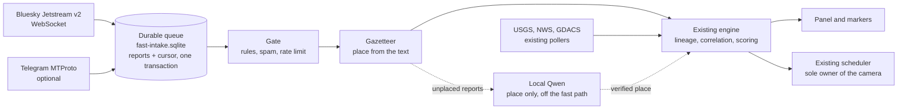

# Fast Intelligence feeds: implementation

Fast Intelligence puts push sources in front of the existing event engine, so a
public post can reach the globe within seconds of being published, as a claim and
never as a fact. It is off unless `GEV_FAST_FEEDS=1` (with `GEV_INTEL_ENABLED=1`).
Audit and the reasoning behind this design: [FAST_FEEDS_AUDIT.md](FAST_FEEDS_AUDIT.md).

## What it does



The rule for all of it: nothing here touches the camera and nothing here decides
what is true. A report becomes an ordinary observation, and the engine's rules
decide what it means.

| Module                                      | Owner of                                                               |
| ------------------------------------------- | ---------------------------------------------------------------------- |
| `server/providers/fastfeeds/index.js`       | Lifetimes, settings, health, the numbers in the panel                  |
| `server/providers/fastfeeds/intake.js`      | Durable bounded queue, cursors, counters, dead letters                 |
| `server/providers/fastfeeds/gate.js`        | Language, topic match, link canonicalisation                           |
| `server/providers/fastfeeds/rules.js`       | English, Russian and Ukrainian terms; add more through language packs  |
| `server/providers/fastfeeds/places.js`      | Naming a place from the text against the bundled gazetteer             |
| `server/providers/fastfeeds/pipeline.js`    | One bounded pass from queue to engine                                  |
| `server/providers/fastfeeds/enricher.js`    | The single question Qwen is asked                                      |
| `server/providers/fastfeeds/adapters/*`     | Bluesky, Telegram                                                      |
| `server/providers/fastfeeds/secretStore.js` | Telegram login under Windows DPAPI                                     |
| `src/intel/fastStatus.js`                   | `candidate` to `retracted`, derived from verification and never stored |
| `src/intel/fastView.js`                     | What the operator chose to see                                         |
| `src/ui/fastIntelPanel.js`                  | The panel                                                              |

Changes to existing fork code are small and listed in
[FORK-MAINTENANCE.md](FORK-MAINTENANCE.md). Upstream files touched: one panel
shell in `layer-panels.html`, and `package.json`/`package-lock.json`.

## From a post to the map

| Report | Trust tag | Source type           | One post                                    | More sources                                          |
| ------ | --------- | --------------------- | ------------------------------------------- | ----------------------------------------------------- |
| Social | community | `social_claim`        | Confidence 0.25, drawn if placed, no camera | Two accounts corroborate; capped at 0.60, no critical |
| Social | reporter  | `secondary_reporting` | Confidence 0.40, a normal unverified report | Normal rules apply                                    |
| Social | official  | `primary_official`    | Confidence 0.85, official                   | Normal rules apply                                    |

`community` is the default. `reporter` and `official` are the operator saying they
checked that source themselves; an account's name proves nothing. `official` is for a
competent authority, never a news organisation, however reliable. Start accounts at
`community` and measure them before moving any to `reporter`.

**Posts do not move the camera.** Whatever its tag or number of sources, an event with
nothing but posts behind it gets no Autopilot shot, tour stop or interruption, and shows
`posts_held_from_camera`. It is still drawn and listed, and an operator can fly to it.
Only an official feed on the same event lifts the hold: a news item or an aggregator
beside the posts does not. `socialCameraEnabled` lifts it for everything; leave it off
until reliability has been shown.

| Status         | Meaning                                                      | On the map                |
| -------------- | ------------------------------------------------------------ | ------------------------- |
| `candidate`    | Thin, or no place. In the activity list only                 | Nothing                   |
| `provisional`  | Unconfirmed, placed, severity 50 or more. Badge FIRST REPORT | Hollow ring               |
| `corroborated` | Independent sources agree                                    | Solid marker              |
| `official`     | An identifiable competent authority says so                  | Solid marker              |
| `contested`    | Someone disputes it                                          | Hollow ring, no camera    |
| `retracted`    | Its source took it back, or an authority did                 | Gone; kept in the archive |
| `resolved`     | Over                                                         | Dimmed, then archived     |

An unconfirmed social claim leaves the map after 6 hours, whatever its category.

### Rules that keep a rumour from becoming a fact

- One account is one source. So is one article, however many accounts link it.
  A quote post or Telegram forward counts as the source it quotes.
- Twenty accounts posting the same words are one source.
- Posts about an event that is already official or corroborated go on its card.
  They renew nothing and do not lift the camera cooldown.
- Nothing a post says changes an official event: not its status, place, measured
  facts or attention. A person's post cannot retract, resolve or dispute an official
  warning, whoever posted it and whatever it links.
- Beside firmer reporting, posts corroborate nothing; they only corroborate each other.
- A post's own timestamp can only make it older. Server time decides the rest, so
  a backdated import stays old and a future date is ignored. Replies are skipped.
- An account correcting itself retracts. Anyone else can only dispute.
- A deleted post stops counting, and its words are removed from the queue and the
  store. That it existed stays in the history. If it was the only source, the
  event is retracted; if others remain, they carry it.
- A person's distance from an event raises attention, never confidence.

### Clocks

Every card keeps these apart (`GET /api/intel/fast/events/<id>`):

| Field                                 | Source                                               |
| ------------------------------------- | ---------------------------------------------------- |
| `event_time`                          | Only when a source states it; `null` otherwise       |
| `first_known_source_publication_time` | Earliest report, even one that arrives late          |
| `first_detected_at`                   | When this system first received it                   |
| `reports[].processed_at`              | When the pipeline finished each report               |
| `first_displayed_at`                  | When it was first served to a map client             |
| `first_corroborated_at`               | When a second source or an official one first agreed |
| `last_material_update_at`             | The last real change                                 |

## Set-up

Add the flag to the instance. In `gev-common.ps1`, on the `autopilot` line:

```
GEV_FAST_FEEDS = '1'
```

### Bluesky

The cursor is a time, not a sequence number: both public hosts honour it alike, and it
is never refused. An outage inside the roughly 36-hour replay window therefore loses
nothing, whichever host answers. One longer than that is reported as a gap, in the
health panel and as a dead letter, because those reports cannot be recovered. A stream
silent for 15 minutes is reopened from the cursor, so a half-open socket cannot read as
healthy.

Open FAST INTELLIGENCE in the left stack, then SOURCES, enter a handle or DID, and
press FOLLOW. The handle is resolved through `public.api.bsky.app` and stored as
its DID, so a renamed account stays followed. Changing sources works from this
computer only; LAN viewers can read but not edit. Nothing connects until at least
one account is listed: no account is chosen for you, because which sources to
trust is your decision. The status reads NO SOURCES CHOSEN until then.

Up to 150 accounts are filtered by the server. Beyond that the whole public post
stream is read and filtered here, which costs about 0.1 % of a core.

### Telegram

**Disabled, pending the review in [TELEGRAM_LIBRARY_REVIEW.md](TELEGRAM_LIBRARY_REVIEW.md).**
It needs a library approved and installed, `GEV_TELEGRAM_ALLOWED=1`, and a login from
`scripts/fast-feeds-telegram-login.mjs`. Do not do any of this until that review is done.
Without them, the status reads OFF and everything else carries on.

### Settings

`.gev-cache/intel/fast-feeds.json`: accounts and channels with their trust tags,
`languagePacks` for more languages, `rawRetentionDays` (default 14, 1 to 30),
`reportsPerAccountPerMinute`, and `placeEnrichment`. Never committed.

## Running a check

```powershell
node scripts/fast-feeds-demo.mjs                    # synthetic drill, contacts nothing
node scripts/fast-feeds-soak.mjs --hours 24         # accelerated soak, contacts nothing
node scripts/fast-feeds-live-probe.mjs --minutes 15 # read-only measurement of the public stream
node --test server/providers/fastfeeds/*.test.mjs src/intel/socialClaims.test.mjs src/intel/fastView.test.mjs
```

The drill also runs in the app: `POST /api/intel/replay` with
`{"scenario":"fast-feed"}`, from this computer.

## Rollout and rollback

Nothing here is deployed by merging. To roll out:

1. Merge the pull request and let Fork Autopilot CI pass.
2. Complete the 24-hour staging run below and read its report.
3. `Deploy-GEV.ps1 -Ref <commit> -Instance autopilot`. The lockfile has not changed.
4. Add `GEV_FAST_FEEDS = '1'` and restart. With the flag off, nothing here runs and NWS
   and GDACS poll as before. The AIS lease and the engine's trust rules are always on.
5. Follow a few accounts and watch HEALTH AND DELAY.

To switch it off and keep the code, remove the flag and restart: no source connects,
and the routes answer `enabled: false`. To go back a version, deploy the rollback
commit recorded in `logs\deploy-autopilot-<time>.json`.

Event changes are in the same store as before, and old records still load. Reports
already ingested stay until they expire; `fast-intake.sqlite` and `fast-feeds.json`
can be deleted while the server is stopped, at the cost of the cursors and sources.

### Staging

Use `scripts/gev-staging.mjs`, from a worktree with no `.env`:

```powershell
git worktree add ..\gev-staging <commit>
cmd /c mklink /J ..\gev-staging\node_modules node_modules
node ..\gev-staging\scripts\gev-staging.mjs --state C:\gev-staging-state
node ..\gev-staging\scripts\gev-staging-monitor.mjs --state C:\gev-staging-state --hours 24
node scripts\fast-feeds-readiness.mjs --state C:\gev-staging-state
```

AISStream allows one connection per key, and its watchdog connects with no browser
involved. This is enforced in code, not left to instructions:

- The launcher refuses a tree whose `.env` holds the key, a live checkout, and ports
  4173 and 4174. It binds to loopback only.
- An isolated instance loads neither the AIS nor the OpenSky provider.
- Any process needs a machine-wide lease to use an AIS key, an exclusive named pipe that
  Windows releases when its owner dies, so a crash or a reboot cannot leave it stuck. A
  second process on this computer refuses to connect and reports `lease-held`, however
  it was started. If the lease itself cannot be taken, AIS connects anyway: a lease
  must never cost the live instance its feed. The live instance takes the lease once
  it runs this code.
- The launcher reads the server's real sockets every 20 s. A connection to AISStream kills
  the server and leaves a machine-wide tripwire file, which blocks every staging start
  until a person removes it. It also refuses to start if it cannot resolve the host, and
  the server stops if the launcher dies.

**Upstream merges.** Fork-only files cannot conflict. Watch `package-lock.json`, the
locale files (append-only) and the panel shell in `layer-panels.html`.

## Status

Nothing is deployed: 4174 runs without this branch.

| State                 | What                                                                                                                                                                                                                                                                               |
| --------------------- | ---------------------------------------------------------------------------------------------------------------------------------------------------------------------------------------------------------------------------------------------------------------------------------- |
| Implemented, live-run | Bluesky Jetstream v2 with cursor and replay, durable queue, gate, gazetteer, delete and edit handling, trust rules, source editing, FAST INTELLIGENCE panel, delay figures. All run against the real stream on staging.                                                            |
| Implemented, reused   | USGS, NWS and GDACS through the existing connectors, with faster NWS and GDACS polling. Their cancellation and update rules are the existing ones.                                                                                                                                 |
| Configured            | Seven verified accounts in `config/fast-feeds.starter.json`, all `community`, used by staging. `GEV_FAST_FEEDS` is off everywhere else.                                                                                                                                            |
| Experimental          | Qwen place enrichment: four synthetic posts on the real model, no long run.                                                                                                                                                                                                        |
| Disabled              | Telegram. The adapter cannot start without `GEV_TELEGRAM_ALLOWED=1`, `teleproto` is out of the lockfile, and no credentials exist. See [TELEGRAM_LIBRARY_REVIEW.md](TELEGRAM_LIBRARY_REVIEW.md).                                                                                   |
| Not started           | Other national CAP feeds; Mastodon and news RSS; broad discovery across all of Bluesky; a map sublayer for source activity; panel filters by region, distance and priority; per-source weights beyond the three trust tags; a Telegram channel editor (settings file only); media. |

## Measurements

All on this machine on 31 October 2026. Every figure says what it was measured on.

**Against the targets**

| Stage                                 | Target (p95)      | Measured                          | Samples             | Result  |
| ------------------------------------- | ----------------- | --------------------------------- | ------------------- | ------- |
| Push delivery to the queue            | under 15 s        | 0.49 s p50, 3.3 s p95, 17 s max   | 442 real posts      | Met     |
| Filter and classify                   | under 15 s        | 9 ms p50, 16 ms p95 per report    | 512 real posts      | Met     |
| Received to initial event             | under 30 s        | 0.23 s p50, 0.37 s p95            | 442 real posts      | Met     |
| Eligible report to shown on the globe | under 60 s        | 4.4 s p50, 11.4 s p95, 12.7 s max | 21 events           | Met     |
| Official alert                        | Poll cycle + 30 s | One NWS alert: 165 s from publish | 1, too few to judge | Unknown |

The first-report time depends on the source: a post reaches the queue in seconds,
but when an event first gets posted is outside this system. The console refreshes
every 10 s, which sets most of the map delay. A claim that had to wait for a place
was shown up to 103 s after its first report, because it could not be drawn until
a report named one. That dashboard reading was corrected after this run: its new
form was checked in tests and against these stored timestamps, not re-run live.

These figures come from staging with 300 very active accounts and a temporary
language pack that passed every post, so that all of them took the full path. That
is a heavier load than normal, on a machine shared with the live instance.

**The public stream**, read-only, 25 minutes, 23,410 top-level posts:

| Measure            | Result                                                         |
| ------------------ | -------------------------------------------------------------- |
| Volume             | 28 frames a second, 26 KB/s (75 and 94 in a busier 15 minutes) |
| Transport delay    | 227 ms p50, 2.5 s p95, 4.7 s max                               |
| Gate cost per post | 27 µs p50, 190 µs p95                                          |
| CPU, memory        | 0.1 % of one core, 129 MB                                      |
| Passed the gate    | 60 posts, 0.26 %                                               |

**Precision on the open stream.** 34 of those 60 were real current reports when
scored by Claude: 57 %. That was the whole public stream under the first rules, and
is not how the system runs. **On the seven starter accounts the gate now measures
84.5 % on an unseen period, scored blind**, with estimated per-post recall of 29 %.
See [FAST_FEEDS_EVALUATION.md](FAST_FEEDS_EVALUATION.md).

**Places.** 27 of the 60 got a place. The 3 wrong cities out of 11 were all
"Melbourne FL" read as Australia, now fixed. One post about Ufa was placed in
Ukraine, because the post named Ukraine, and that kind of error remains.

**Local model.** Qwen read 4 of 4 synthetic posts correctly, including one that told
it to answer Atlantis. Each took 1.6 to 46 s on a GPU already at 99 %. It is capped
at 20 questions an hour and gives way to voice and to anyone else. Its GPU share
was not measured separately.

**Accelerated soak** (synthetic, `scripts/fast-feeds-soak.mjs`, commit `5c61bdcd`):

24 simulated hours at 5 posts a second through the real adapter, queue, gate and
engine on real SQLite files, with an outage and replay every hour and a flood of
10,000 every six.

| Measure             | Result                                                |
| ------------------- | ----------------------------------------------------- |
| Frames              | 463,731 received and all accounted for: none lost     |
| Replayed            | 4,600 frames across 23 outages, every one ignored     |
| Memory              | 153 MB in hour 1, 279 MB by hour 6, 285 MB at hour 24 |
| Slowest pass        | 0.75 s, during a flood (2.2 s before the time budget) |
| Queue after a flood | 10,000 waiting, drained to 0 by the end of each hour  |
| Disk                | 469 MB of queue and 113 MB of evidence in the day     |

That disk figure is high because 5 posts a second is about 430,000 reports a day.
A few chosen accounts make far less. Filtered records go after two days, so it
levels off at about twice that at this rate; on C:, with 16 GB free, keep an eye on
it if you follow hundreds of busy accounts.

**Not done: 24 hours against the live stream.** Staging ran for about 50 minutes in
total, with restarts. The soak is simulated traffic on a simulated clock. It shows
how the code behaves over a long run, and says nothing about a real service staying
up for a day.

## Test matrix

Numbers are the specification's. The tests are in
`server/providers/fastfeeds/*.test.mjs`, `src/intel/socialClaims.test.mjs` and, where
noted, the existing suites.

| #   | Case                                        | Test                                                                             |
| --- | ------------------------------------------- | -------------------------------------------------------------------------------- |
| 1   | New push report end to end                  | `1: a pushed post is stored, timestamped and reaches the engine once`            |
| 2   | Out of order, delayed, clock skew           | `2: posts arriving out of order keep their own times`, `publication time: …`     |
| 3   | Old post, repost, forward renews nothing    | `3: an imported old post…`, `3: a quote post…`, `Telegram: a message keeps…`     |
| 4   | One agency across channels is one origin    | `3 and 4: a shared article, however linked, is one origin`                       |
| 5   | Two independent reporters correlate         | `5: two independent accounts with different words correlate`                     |
| 6   | Like events in nearby towns stay apart      | `6: like incidents in nearby towns stay apart`                                   |
| 7   | Fabricated GPS, country-only claim          | `7: a country-only claim gets no point…`, `a copy of one post shared by twenty…` |
| 8   | Contradicted, then retracted                | `8: a source correcting itself retracts; someone else only disputes`             |
| 9   | Official alert modified, expired, cancelled | Existing: `USGS features…`, `NWS: VTEC ties updates…`, `tsunami centres: …`      |
| 10  | Reconnect with cursor replay                | `10: an outage resumes from the cursor…`                                         |
| 11  | Telegram unconfigured, the rest runs        | `11: Telegram with no login…`                                                    |
| 12  | Rate limit, timeout, malformed, oversized   | `12: malformed, oversized and hostile frames…`, `Telegram: a network failure…`   |
| 13  | Flood of 10,000                             | `13: a 10,000-message flood stays bounded, counted and fair`                     |
| 14  | Model timeout, backlog drains               | `14: a model timeout changes nothing…`                                           |
| 15  | Unverified report, no interruption          | `Autopilot never flies to an unverified post…`                                   |
| 16  | Critical official warning interrupts        | Existing: `A09: a qualified critical event interrupts…`                          |
| 17  | Stale update gives no camera renewal        | Existing: `an old incident arriving now…`, `A06: …`                              |
| 18  | Distant events rotate, nearby cluster       | Existing: `A03: distant clusters rotate…`, `A02: …`                              |
| 19  | Restart keeps IDs, cursors, sources         | `19: a restart keeps events, the cursor, the sources and the queue`              |
| 20  | No outside inference                        | Existing: `only loopback base URLs are accepted…`                                |
| 21  | Outage is not a lull                        | `21: a dead stream reads as a dead stream…`                                      |
| 22  | UTC, daylight saving, date line             | `22: times are compared as instants…`, `22: an instant across…`, existing `A04`  |
| 23  | Edit or delete reconciles evidence          | `23: an edit updates the record…`, `a deleted post stops counting…`              |
| 24  | Proximity raises attention only             | `proximity raises attention, never the confidence in a post`                     |

## Limits

- **Coverage is what you list.** A first report only exists if a followed account
  posts it. No minutes-to-discovery promise can be made for the world, and an empty
  map says nothing about it. The panel says so.
- **The gate reads words.** It catches stories that date themselves, but a follow-up
  to an older event can still pass, and it passes about 29 % of real-event posts.
- **Places are approximate.** A town named in a post is not proof of where anything
  happened, so they are marked `needs_verification`. Towns not in Natural Earth stay
  unresolved unless the model can read them, and two towns sharing a name stay
  unresolved unless a country follows.
- **Telegram has never met a real server.** It is disabled, and its adapter has only
  been tested against a fake client.
- **Translations** of the 70 new strings have not had a native speaker's review.
