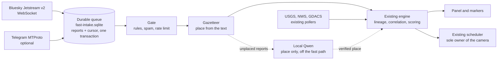

# Fast Intelligence feeds: implementation

Fast Intelligence puts push sources in front of the existing event engine, so a
public post can reach the globe within seconds of being published, as a claim and
never as a fact. It is off unless `GEV_FAST_FEEDS=1` (with `GEV_INTEL_ENABLED=1`).
Audit and the reasoning behind this design: [FAST_FEEDS_AUDIT.md](FAST_FEEDS_AUDIT.md).

## What it does



The rule for all of it: nothing here touches the camera and nothing here decides
what is true. A report becomes an ordinary observation, and the engine's rules
decide what it means.

| Module                                      | Owner of                                                               |
| ------------------------------------------- | ---------------------------------------------------------------------- |
| `server/providers/fastfeeds/index.js`       | Lifetimes, settings, health, the numbers in the panel                  |
| `server/providers/fastfeeds/intake.js`      | Durable bounded queue, cursors, counters, dead letters                 |
| `server/providers/fastfeeds/gate.js`        | Language, topic match, link canonicalisation                           |
| `server/providers/fastfeeds/rules.js`       | English, Russian and Ukrainian terms; add more through language packs  |
| `server/providers/fastfeeds/places.js`      | Naming a place from the text against the bundled gazetteer             |
| `server/providers/fastfeeds/pipeline.js`    | One bounded pass from queue to engine                                  |
| `server/providers/fastfeeds/enricher.js`    | The single question Qwen is asked                                      |
| `server/providers/fastfeeds/adapters/*`     | Bluesky, Telegram                                                      |
| `server/providers/fastfeeds/secretStore.js` | Telegram login under Windows DPAPI                                     |
| `src/intel/fastStatus.js`                   | `candidate` to `retracted`, derived from verification and never stored |
| `src/intel/fastView.js`                     | What the operator chose to see                                         |
| `src/ui/fastIntelPanel.js`                  | The panel                                                              |

Changes to existing fork code are small and listed in
[FORK-MAINTENANCE.md](FORK-MAINTENANCE.md). Upstream files touched: one panel
shell in `layer-panels.html`, and `package.json`/`package-lock.json`.

## From a post to the map

| Report | Trust tag | Source type           | One post                                    | More sources                                          |
| ------ | --------- | --------------------- | ------------------------------------------- | ----------------------------------------------------- |
| Social | community | `social_claim`        | Confidence 0.25, drawn if placed, no camera | Two accounts corroborate; capped at 0.60, no critical |
| Social | reporter  | `secondary_reporting` | Confidence 0.40, a normal unverified report | Normal rules apply                                    |
| Social | official  | `primary_official`    | Confidence 0.85, official                   | Normal rules apply                                    |

`community` is the default. `reporter` and `official` are the operator saying they
checked that source themselves; an account's name proves nothing.

| Status         | Meaning                                                      | On the map                |
| -------------- | ------------------------------------------------------------ | ------------------------- |
| `candidate`    | Thin, or no place. In the activity list only                 | Nothing                   |
| `provisional`  | Unconfirmed, placed, severity 50 or more. Badge FIRST REPORT | Hollow ring               |
| `corroborated` | Independent sources agree                                    | Solid marker              |
| `official`     | An identifiable competent authority says so                  | Solid marker              |
| `contested`    | Someone disputes it                                          | Hollow ring, no camera    |
| `retracted`    | Its source took it back, or an authority did                 | Gone; kept in the archive |
| `resolved`     | Over                                                         | Dimmed, then archived     |

An unconfirmed social claim leaves the map after 6 hours, whatever its category.

### Rules that keep a rumour from becoming a fact

- One account is one source. So is one article, however many accounts link it.
  A quote post or Telegram forward counts as the source it quotes.
- Twenty accounts posting the same words are one source.
- Posts about an event that is already official or corroborated go on its card.
  They renew nothing and do not lift the camera cooldown.
- A post's own timestamp can only make it older. Server time decides the rest, so
  a backdated import stays old and a future date is ignored. Replies are skipped.
- An account correcting itself retracts. Anyone else can only dispute.
- A deleted post stops counting, and its words are removed from the queue and the
  store. That it existed stays in the history. If it was the only source, the
  event is retracted; if others remain, they carry it.
- A person's distance from an event raises attention, never confidence.

### Clocks

Every card keeps these apart (`GET /api/intel/fast/events/<id>`):

| Field                                 | Source                                               |
| ------------------------------------- | ---------------------------------------------------- |
| `event_time`                          | Only when a source states it; `null` otherwise       |
| `first_known_source_publication_time` | Earliest report, even one that arrives late          |
| `first_detected_at`                   | When this system first received it                   |
| `reports[].processed_at`              | When the pipeline finished each report               |
| `first_displayed_at`                  | When it was first served to a map client             |
| `first_corroborated_at`               | When a second source or an official one first agreed |
| `last_material_update_at`             | The last real change                                 |

## Set-up

Add the flag to the instance. In `gev-common.ps1`, on the `autopilot` line:

```
GEV_FAST_FEEDS = '1'
```

### Bluesky

Open FAST INTELLIGENCE in the left stack, then SOURCES, enter a handle or DID, and
press FOLLOW. The handle is resolved through `public.api.bsky.app` and stored as
its DID, so a renamed account stays followed. Changing sources works from this
computer only; LAN viewers can read but not edit. Nothing connects until at least
one account is listed: no account is chosen for you, because which sources to
trust is your decision. The status reads NO SOURCES CHOSEN until then.

Up to 150 accounts are filtered by the server. Beyond that the whole public post
stream is read and filtered here, which costs about 0.1 % of a core.

### Telegram (optional)

1. Get an `api_id` and `api_hash` at <https://my.telegram.org>.
2. Run `node scripts/fast-feeds-telegram-login.mjs` in a terminal on the server and
   follow the prompts. The login is encrypted for this Windows user and stored at
   `%LOCALAPPDATA%\GodsEyeView\telegram-login.dpapi`.
3. List channels in `.gev-cache/intel/fast-feeds.json`
   (shape: [config/fast-feeds.example.json](../config/fast-feeds.example.json)) with
   `"telegram": { "enabled": true, ... }`, and restart.

Only public channels with a username are read, and only text. Without a login the
status reads AUTH REQUIRED and everything else carries on.

### Settings

`.gev-cache/intel/fast-feeds.json`: accounts and channels with their trust tags,
`languagePacks` for more languages, `rawRetentionDays` (default 14, 1 to 30),
`reportsPerAccountPerMinute`, and `placeEnrichment`. Never committed.

## Running a check

```powershell
node scripts/fast-feeds-demo.mjs                    # synthetic drill, contacts nothing
node scripts/fast-feeds-soak.mjs --hours 24         # accelerated soak, contacts nothing
node scripts/fast-feeds-live-probe.mjs --minutes 15 # read-only measurement of the public stream
node --test server/providers/fastfeeds/*.test.mjs src/intel/socialClaims.test.mjs src/intel/fastView.test.mjs
```

The drill also runs in the app: `POST /api/intel/replay` with
`{"scenario":"fast-feed"}`, from this computer.

## Rollout and rollback

Nothing here is deployed by merging. To roll out:

1. Merge the pull request and let Fork Autopilot CI pass.
2. Stop first: the lockfile changed, and `npm ci` cannot replace `node_modules`
   under a running server. `Stop-GEV.ps1 -Instance autopilot`.
3. `Deploy-GEV.ps1 -Ref <commit> -Instance autopilot`, then
   `Start-GEV.ps1 -Instance autopilot -NoBrowser`.
4. Add `GEV_FAST_FEEDS = '1'` and restart. With the flag off, the code is inert.
5. Follow a few accounts and watch HEALTH AND DELAY.

To switch it off and keep the code, remove the flag and restart: no source connects,
and the routes answer `enabled: false`. To go back a version, deploy the rollback
commit recorded in `logs\deploy-autopilot-<time>.json`.

Event changes are in the same store as before, and old records still load. Reports
already ingested stay until they expire; `fast-intake.sqlite` and `fast-feeds.json`
can be deleted while the server is stopped, at the cost of the cursors and sources.

**Never run a second instance with the real AIS key.** See the AISStream note in the
audit: the watchdog connects with no browser involved, and AISStream allows one
connection per key.

**Upstream merges.** Fork-only files cannot conflict. Watch `package-lock.json`, the
locale files (append-only) and the panel shell in `layer-panels.html`.

## Status

@@STATUS@@

## Measurements

@@MEASUREMENTS@@

## Test matrix

Numbers are the specification's. The tests are in
`server/providers/fastfeeds/*.test.mjs`, `src/intel/socialClaims.test.mjs` and, where
noted, the existing suites.

| #   | Case                                        | Test                                                                             |
| --- | ------------------------------------------- | -------------------------------------------------------------------------------- |
| 1   | New push report end to end                  | `1: a pushed post is stored, timestamped and reaches the engine once`            |
| 2   | Out of order, delayed, clock skew           | `2: posts arriving out of order keep their own times`, `publication time: …`     |
| 3   | Old post, repost, forward renews nothing    | `3: an imported old post…`, `3: a quote post…`, `Telegram: a message keeps…`     |
| 4   | One agency across channels is one origin    | `3 and 4: a shared article, however linked, is one origin`                       |
| 5   | Two independent reporters correlate         | `5: two independent accounts with different words correlate`                     |
| 6   | Like events in nearby towns stay apart      | `6: like incidents in nearby towns stay apart`                                   |
| 7   | Fabricated GPS, country-only claim          | `7: a country-only claim gets no point…`, `a copy of one post shared by twenty…` |
| 8   | Contradicted, then retracted                | `8: a source correcting itself retracts; someone else only disputes`             |
| 9   | Official alert modified, expired, cancelled | Existing: `USGS features…`, `NWS: VTEC ties updates…`, `tsunami centres: …`      |
| 10  | Reconnect with cursor replay                | `10: an outage resumes from the cursor…`                                         |
| 11  | Telegram unconfigured, the rest runs        | `11: Telegram with no login…`                                                    |
| 12  | Rate limit, timeout, malformed, oversized   | `12: malformed, oversized and hostile frames…`, `Telegram: a network failure…`   |
| 13  | Flood of 10,000                             | `13: a 10,000-message flood stays bounded, counted and fair`                     |
| 14  | Model timeout, backlog drains               | `14: a model timeout changes nothing…`                                           |
| 15  | Unverified report, no interruption          | `Autopilot never flies to an unverified post…`                                   |
| 16  | Critical official warning interrupts        | Existing: `A09: a qualified critical event interrupts…`                          |
| 17  | Stale update gives no camera renewal        | Existing: `an old incident arriving now…`, `A06: …`                              |
| 18  | Distant events rotate, nearby cluster       | Existing: `A03: distant clusters rotate…`, `A02: …`                              |
| 19  | Restart keeps IDs, cursors, sources         | `19: a restart keeps events, the cursor, the sources and the queue`              |
| 20  | No outside inference                        | Existing: `only loopback base URLs are accepted…`                                |
| 21  | Outage is not a lull                        | `21: a dead stream reads as a dead stream…`                                      |
| 22  | UTC, daylight saving, date line             | `22: times are compared as instants…`, `22: an instant across…`, existing `A04`  |
| 23  | Edit or delete reconciles evidence          | `23: an edit updates the record…`, `a deleted post stops counting…`              |
| 24  | Proximity raises attention only             | `proximity raises attention, never the confidence in a post`                     |

## Limits

- **Coverage is what you list.** A first report only exists if a followed account
  posts it. No minutes-to-discovery promise can be made for the world, and an empty
  map says nothing about it. The panel says so.
- **The gate reads words.** It cannot tell a retrospective article from a live
  event, and its recall is unmeasured: there is no labelled set of what it missed.
- **Places are approximate.** A town named in a post is not proof of where anything
  happened, so they are marked `needs_verification`. Towns not in Natural Earth stay
  unresolved unless the model can read them, and two towns sharing a name stay
  unresolved unless a country follows.
- **Telegram has never met a real server.** The adapter is tested against a fake
  client; the library's API was checked by loading it, nothing more.
- **`teleproto` is young.** One maintainer, and its crypto dependency `cifrante` was
  three weeks old when pinned. It loads only after a Telegram login, and that login
  is an account credential: decide whether you are comfortable before signing in.
- **Translations** of the 70 new strings have not had a native speaker's review.
